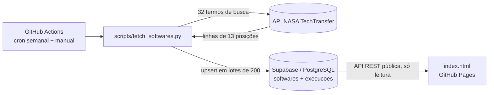
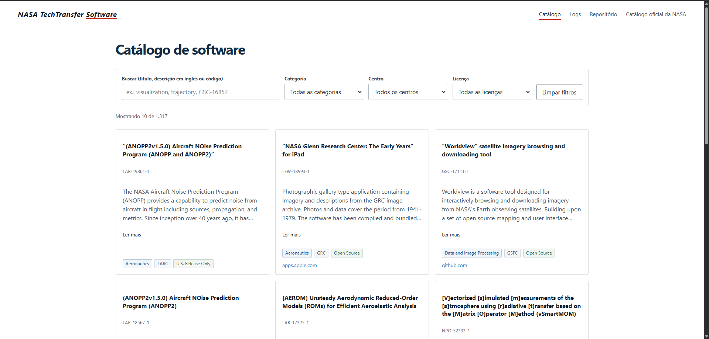

# TechTransfer-Software

Pipeline de dados com a API aberta **NASA TechTransfer / Software**: coleta automática com GitHub Actions, armazenamento em PostgreSQL (Supabase) e painel web no GitHub Pages.

Trabalho da Atividade Avaliativa do 3º Trimestre (Grupo 11).

| | |
|---|---|
| **Organização** | https://github.com/TechTransfer-NASA |
| **Repositório** | https://github.com/TechTransfer-NASA/TechTransfer-Software |
| **Painel (GitHub Pages)** | `https://techtransfer-nasa.github.io/TechTransfer-Software/` |
| **Banco** | Supabase, projeto `TechTransfer-Software-DB` (região São Paulo) |
| **Integrantes** | Arthur, Helen e Mateus Rosler |

---

## 1. A API

O **NASA TechTransfer** reúne as tecnologias que a NASA disponibiliza para uso fora da agência. Este projeto usa o catálogo de **software** (software.nasa.gov): programas desenvolvidos pelos centros da NASA, com título, descrição, categoria, centro de origem, tipo de licença (Open Source, U.S. Release Only etc.) e links de repositório ou download.

- Endpoint usado: `https://technology.nasa.gov/api/api/software/{termo}`
- Endereço documentado pela NASA: `api.nasa.gov/techtransfer/software/` (usa `NASA_API_KEY`); no nosso teste ele redirecionou para o portal TechTransfer, e o pipeline usa o endpoint do portal diretamente
- Não há "listar tudo": a API devolve os itens que contêm o termo buscado.

### Particularidades encontradas

Essas características foram descobertas medindo a API antes de modelar o banco:

| Característica | O que descobrimos |
|---|---|
| Formato | Cada item é uma **lista de 13 posições**, não um objeto com campos nomeados |
| Campos vazios | Muitas posições vêm como `""`; no banco viram `NULL` |
| Paginação | **Não existe**: a resposta traz todos os itens de uma vez (`perpage` e `page` são ignorados) |
| Teto | Respostas são cortadas em **1000 itens**; o campo `total` mostra o número real |
| Busca | Por **palavra inteira**, sem diferenciar maiúsculas. Os códigos dos itens (GSC-, ARC-, NPO-...) também são pesquisáveis |
| Textos | Vêm com `<span class="highlight">` ao redor do termo buscado, tags HTML (`<p>`) e entidades (`&reg;`, `&apos;`) |
| Centros | Mesma sigla com grafias diferentes (`LARC` e `LaRC`) |
| Chave | O endpoint direto não exige chave; o do `api.nasa.gov` usa `NASA_API_KEY` |

Mapa das posições usadas em software:

| Posição | Campo |
|---|---|
| 0 | id interno da NASA |
| 1 | código (ex.: `GSC-16852-1`), **chave natural** |
| 2 | título |
| 3 | descrição |
| 5 | categoria |
| 6 | licença / tipo de release |
| 7 | notas de acesso (texto livre) |
| 8 | links (repositório, download), às vezes mais de um separado por `;` |
| 9 | centro da NASA |
| 12 | score da busca (só vale dentro de uma busca; descartado) |

As posições 4 (repete o código), 10 e 11 (vazias em software) são ignoradas.

---

## 2. Arquitetura



1. O **workflow** roda toda segunda-feira (e pode ser disparado manualmente).
2. O **script** busca 32 termos na API, limpa e normaliza os dados, remove os repetidos pelo código e envia ao Supabase.
3. O **Supabase** guarda os softwares e o histórico das execuções e expõe uma API REST.
4. O **painel** lê essa API com a chave pública (somente leitura).

### Por que 32 termos?

Como a API só busca por termo, a cobertura do catálogo depende dos termos usados. A lista combina **prefixos de código dos centros** (`arc`, `lar`, `lew`, `gsc`, `msc`, `mfs`, `npo`, `ksc`, `drc`, `ssc`...), que juntos cobrem praticamente todo o catálogo, com **palavras comuns** (`system`, `data`, `space`...) como rede de segurança. Em testes de descoberta, dezenas de termos adicionais não trouxeram nenhum item novo.

---

## 3. Estrutura do repositório

```
TechTransfer-Software/
├── index.html                  redirect para o painel (GitHub Pages)
├── README.md
├── pages/, css/ e js/          páginas, estilos e scripts do painel
├── scripts/
│   └── fetch_softwares.py      coleta, deduplicação e upsert
├── sql/
│   └── setup.sql               tabelas, constraint UNIQUE, RLS e GRANTs
├── .github/workflows/
│   └── update-data.yml         agendamento do pipeline
└── docs/
    ├── tutorial.pdf
    ├── ai-interaction.md
    ├── reflexao.md
    └── apresentacao.pdf
```

---

## 4. Banco de dados

Definido em [`sql/setup.sql`](sql/setup.sql) (pode ser executado mais de uma vez).

**`softwares`**: dados da API.
- `codigo` com **constraint UNIQUE**: permite o upsert sem duplicatas.
- Campos: `id_nasa`, `titulo`, `descricao`, `categoria`, `centro`, `centro_nome`, `licenca`, `notas_acesso`, `urls` (lista), `url_detalhe` (gerada a partir do código), `raw` (linha original), `ativo`, `primeira_vez_visto`, `ultima_vez_visto`, `busca` (índice de busca textual).

**`execucoes`**: log de cada execução do pipeline.
- `status` (`concluido`, `erro_parcial`, `erro_critico`), `registros_processados`, `registros_novos`, `registros_inativados`, `lotes`, `erros`, `termos_executados`, `mensagem` e `detalhes` (resultado de cada termo).

**Segurança no banco**
- RLS ativo nas duas tabelas, com política de leitura pública.
- `GRANT SELECT` para `anon` e `authenticated`; `GRANT ALL` apenas para `service_role`.

---

## 5. Pipeline (`scripts/fetch_softwares.py`)

1. Consulta a API para cada termo (pausa de 1 s entre chamadas, até 3 tentativas por chamada).
2. Valida cada linha (13 posições, id e código presentes, score numérico) e normaliza: remove HTML e destaques, decodifica entidades, converte `""` em `NULL`, padroniza o centro em maiúsculas e a categoria para o nome do site.
3. **Deduplica por `codigo` antes do upsert**, porque o mesmo software aparece em várias buscas (isso evita o erro PostgreSQL 21000).
4. Faz upsert em lotes de 200 linhas.
5. Marca como inativos os softwares não vistos há 21 dias (somente em execuções 100% limpas).
6. Registra a execução em `execucoes`.

**Status da execução**

| Status | Quando |
|---|---|
| `concluido` | Nenhum erro |
| `erro_parcial` | Alguma chamada falhou, alguma resposta foi cortada no teto de 1000, linhas inválidas ou lote que falhou |
| `erro_critico` | Coleta falhou na maior parte, nenhum dado, ou a coleta veio com menos da metade do que o banco já tem (gravação cancelada por segurança) |

Em qualquer status diferente de `concluido` o script termina com `sys.exit(1)`, e o erro fica visível no GitHub Actions.

Teste local, sem gravar no banco:

```bash
pip install requests
python scripts/fetch_softwares.py --dry-run
```

---

## 6. Workflow (`.github/workflows/update-data.yml`)

- **Agendamento:** `cron` toda segunda-feira às 06:00 UTC, mais execução manual (`workflow_dispatch`).
- **Boas práticas:** `permissions: contents: read`, `concurrency` (uma execução por vez) e `timeout-minutes: 20`.

---

## 7. Como configurar

O passo a passo completo, com prints, está em [`docs/tutorial.pdf`](docs/tutorial.pdf). Resumo:

1. Criar a organização e o repositório no GitHub (nomes da Tabela 02 do enunciado).
2. Criar o projeto no Supabase (região South America, São Paulo) e executar `sql/setup.sql` no SQL Editor.
3. Em *Settings → Secrets and variables → Actions*, criar os **Secrets**:

| Secret | Conteúdo |
|---|---|
| `SUPABASE_URL` | URL do projeto (`https://xxxx.supabase.co`) |
| `SUPABASE_SERVICE_KEY` | chave **secret** (service_role) do Supabase |
| `NASA_API_KEY` | chave gratuita de api.nasa.gov |

   Variável opcional: `NASA_API_BASE` (troca o endpoint da NASA).
4. Executar o workflow em *Actions → Run workflow* e conferir as tabelas no Supabase.
5. Ativar o GitHub Pages em *Settings → Pages* (branch `main`, pasta root).

---

## 8. Segurança

- A chave `SUPABASE_SERVICE_KEY` fica **somente** nos Secrets do GitHub. Nunca é commitada nem aparece no `index.html`.
- O painel usa apenas a **publishable key** (somente leitura, limitada pela RLS).
- O script substitui as chaves por `***` em mensagens de erro antes de gravar na tabela `execucoes`, que é pública.
- Todo valor vindo do banco é passado por `escapeHtml()` antes de entrar no HTML do painel.

---

## 9. Painel

O painel é composto por páginas estáticas que consultam a API REST do Supabase direto do navegador (com a publishable key, somente leitura).

- **Catálogo** (`pages/catalogo.html`): busca por texto (em inglês) ou código, filtros por categoria, centro e licença, cards com título, código, descrição (botão *Ler mais*), etiquetas e link do repositório, contador de resultados e botão *Carregar mais*.
- **Logs** (`pages/logs.html`): histórico das execuções do pipeline lido da tabela `execucoes`, com a data da última atualização, o status de cada coleta e o resultado por termo de busca.



---

## 10. Equipe e divisão de responsabilidades

| Responsabilidade | Integrante(s) |
|---|---|
| Pipeline (script e workflow) | `Mateus Rosler` |
| Banco de dados (Supabase) | `Arthur Gehlen` |
| Painel (GitHub Pages) | `Arthur Gehlen` |
| Documentação e apresentação | `Helen` |

---

## 11. Uso de IA generativa

O grupo utilizou IA generativa (Claude, da Anthropic) como ferramenta de apoio na investigação da API, na identificação e análise dos campos retornados e no desenvolvimento do script Python responsável pela coleta dos softwares. A IA também auxiliou na organização e elaboração da documentação técnica. A implementação, revisão e validação dos resultados foram realizadas pelo grupo, incluindo testes com a API da NASA e o armazenamento dos dados no Supabase.

- Histórico completo dos prompts: [`docs/ai-interaction.md`](docs/ai-interaction.md)
- Análise crítica do uso: [`docs/reflexao.md`](docs/reflexao.md)

---

## 12. Limitações conhecidas

- A API não tem paginação nem lista completa: a cobertura do catálogo é **verificada por testes de saturação** (novos termos deixaram de trazer itens), não por contagem oficial. O site da NASA não exibe o total de itens.
- Respostas acima de 1000 itens são cortadas pela API. Nenhum termo da lista atual chega perto disso em software, e o pipeline sinaliza `erro_parcial` se isso ocorrer.
- A busca por texto do painel usa o índice em inglês; termos em português retornam poucos resultados.